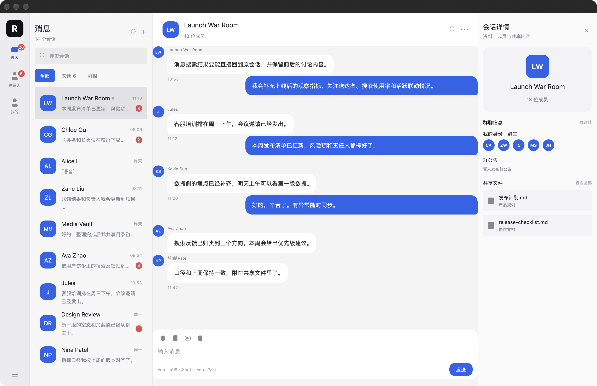

# demo-desktop-app

RedCode IM 2.0 **PC 端产品界面**的 GPUI 复刻。

- **设计源**：`~/code/redcode-im/im-ui-html` 的 `#/pc-design` 路由（纯 HTML + CSS + JS）
- **实现**：Rust + GPUI 0.2.2
- **数据**：全部为内存 mock，不接任何真实 API



---

## 运行

```bash
cd demo-desktop-app
cargo run --release
```

约 5.6MB 单二进制，macOS 走 Metal 渲染。

> **构建前置**：macOS 需要安装 Metal Toolchain 组件，否则 gpui 编译期调 `metal` 着色器编译器会失败：
> ```bash
> xcodebuild -downloadComponent MetalToolchain   # 838.9 MB
> ```

---

## 复刻范围

**产品界面**（四列工作台），不包含设计源预览器的外壳 —— 顶部那排「入口/规范/PC/移动 + 浅色/深色 + 1K/1.5K/2K/4K」属于设计工具本身，不是 RedCode 的产品界面。

| 区域 | 内容 |
|---|---|
| 导航轨（72px） | R 品牌标、聊天（未读 20）、联系人（未读 6）、我的、底部菜单 |
| 会话列表（296px） | 「消息 / N 个会话」标题、搜索框、全部/未读/群聊筛选、14 条会话（头像、名字、置顶旗、时间、摘要、未读徽标） |
| 聊天区（flex，≥464px） | 群头像 + 群名 + 成员数、搜索/更多、消息气泡流、输入区 |
| 会话详情（288px） | 群资料卡、群聊信息（我的身份、成员头像组）、群公告、共享文件列表 |

### 已实现的交互

- 点击导航项切换 聊天 / 联系人 / 我的（后两者为 mock 占位）
- 点击会话切换当前会话
- 点击筛选 chip 过滤会话列表
- 点击「发送」追加一条自己的 mock 消息
- 点击详情面板的 ✕ 收起详情栏（窗口宽度 < 1120px 时自动收起）

---

## 设计 token

全部取自设计源 `.desktop-stage--product` 作用域的**浏览器计算样式**，逐项核实而非目测。完整清单见 `src/theme.rs`。

| 角色 | 浅色 | 用途 |
|---|---|---|
| App 背景 | `#FFFFFF` | 主卡 |
| 导航轨 | `#ECECEF` | |
| 会话列表面板 | `#F7F7F8` | |
| 聊天内容区 | `#F4F4F5` | |
| 详情面板 | `#FAFAFA` | |
| 强调色 | `#2563EB` | 主动作、气泡、徽标 |
| 文字 | `#202126` / `#292A2E` / `#85888F` / `#A0A2A8` | 主/正文/次级/三级 |
| 描边 | `#E5E6E8` / `#ECECEF` / `#DEDFE2` | |
| 输入框底 | `#EAEAEB` | |

尺寸：导航 72 / 列表 296 / 详情 288 / 聊天区最小 464（4 列合计最小 1120）；
行高 76（会话）/ 72（消息槽位）；圆角 22/18/16/14/12/6；字号 20/16/14/12/11.5/10。

`src/theme.rs` 里另有一套深色 palette（强调色 `#5B8CFF`，来自 `im-ui-html/docs/design-tokens.md`），
当前未接入 —— 设计源里深色切换属于预览器能力，产品侧应在设置窗口提供。

---

## GPUI 0.2.2 的实现要点

gpui 0.2.2 **没有 widget 库**（Button/Label/Input/Editor 都在 Zed 的 `crates/ui` 里，GPL-3.0 不可用），
全部界面由 `div` + 少量原语拼出。踩过的坑：

| 事项 | 结论 |
|---|---|
| 可点击元素 | 必须先 `.id(...)`。`InteractiveElement::id()` 返回 `Stateful<Div>`，只有它实现了 `StatefulInteractiveElement`，才有按值版 `on_click` |
| 圆角 | `style().corner_radii` 的字段是 `Option<AbsoluteLength>`，需 `Some(px(n).into())` |
| 数值样式 | `radius()` 这类辅助函数要接 `Div` 而非 `Stateful<Div>`，所以顺序是 **先 radius 再 id 再 on_click** |
| 读取自身状态 | `render` 里不能用 `cx.entity().read(cx)`，会 panic「already being updated」。直接读 `self` |
| 虚拟列表 | `uniform_list` + `cx.processor`。processor 闭包拿到 `&mut Self` 与 `&mut Context<Self>`，**不要捕获外层 `cx`** |
| 虚拟列表条目 | 必须是等高槽位（`uniform_list` 要求），消息气泡因此固定 72px 槽位 |
| 滚动容器 | `Div` 没有 `overflow_scroll` 样式方法（该方法只在 `StatefulInteractiveElement` 上，而它只实现给了 `Img`）。用 `uniform_list` 自带滚动，或 `style().overflow.y = Some(Overflow::Scroll)` |
| 横向滚动 | `uniform_list` 只支持纵向。宽表需自行处理列宽与横向偏移同步 |

### 已知还原差异

1. **文本不自动省略 / 不按容器宽度换行**。设计稿里会话摘要是单行省略（`text-overflow: ellipsis`），gpui 0.2.2 无对应能力，本实现会折行。
2. **消息区最后一条被输入区压住**。`uniform_list` 的槽位高固定，与可变高气泡不匹配。
3. **图标用 div 几何图形近似**。设计源用 SVG，gpui 0.2.2 虽有 `svg()` 元素但只支持单条 path 填充，未接入真实图标资源。
4. **输入区是静态占位**。gpui 0.2.2 无输入控件（`crates/ui` 的 Input 在 GPL crate 里），当前只做「发送」按钮追加 mock 消息。
5. **深色主题未接入**（palette 已备好）。

---

## 目录

```
demo-desktop-app/
├── Cargo.toml
└── src/
    ├── main.rs      # 应用状态 + 全部界面渲染
    ├── theme.rs     # 设计 token（浅色 + 深色 palette）
    └── data.rs      # mock 会话 / 消息 / 成员 / 共享文件
```
